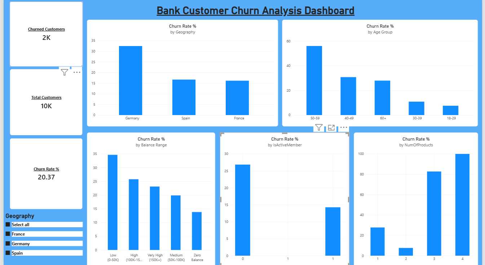

# Bank Customer Churn Analysis

## Overview
An end-to-end data analytics project analyzing customer churn patterns for a bank, 
using Python for data cleaning, MySQL for analysis, and Power BI for visualization.

## Tools Used
- **Python** (pandas, sqlalchemy) — Data cleaning and loading into MySQL
- **MySQL** — Data storage and SQL-based analysis
- **Power BI** — Interactive dashboard for visualizing insights

## Dataset
Bank Customer Churn Modeling dataset (10,000 customer records) — sourced from Kaggle.

## Process
1. Loaded raw CSV data using pandas
2. Cleaned data: checked for nulls/duplicates, removed unnecessary columns (RowNumber, CustomerId, Surname)
3. Pushed cleaned data into a MySQL database using SQLAlchemy
4. Wrote SQL queries to analyze churn across multiple dimensions
5. Built an interactive Power BI dashboard connected directly to MySQL

## Key Insights
- **Overall churn rate: 20.37%** (2,037 of 10,000 customers)
- **Germany has the highest churn (32.44%)** — nearly double France and Spain
- **Customers aged 50-59 churn the most (56.04%)** — over 7x higher than customers under 30
- **Customers with 3-4 products churn dramatically more** (83-100%) compared to those with 2 products (7.58%)
- **Inactive members churn nearly 2x more** than active members (26.85% vs 14.27%)
- **Zero-balance customers churn the least (13.82%)**, while high-balance customers churn more

## Dashboard Preview

## Files
- `clean_data.ipynb` — Python data cleaning and MySQL loading script
- `churn_analysis_queries.sql` — SQL analysis queries
- `Bank_Churn_Dashboard.pbix` — Power BI dashboard file
- `dashboard_screenshot.png` — Preview image of the final dashboard